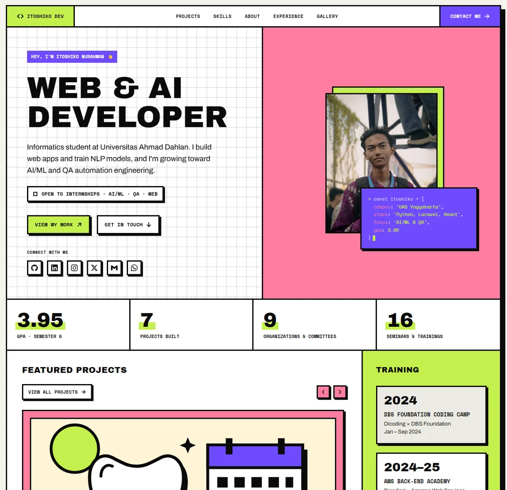

# Itoshiko Nurahman — Portfolio

[](https://itoshiko-nurahman.dev)



Personal portfolio of an Informatics student at Universitas Ahmad Dahlan (Yogyakarta), open to internships in AI/ML, QA automation and web development.

**Live: [itoshiko-nurahman.dev](https://itoshiko-nurahman.dev)**

## What's inside

- **Hero and stats** with an "open to internships" badge and quick facts
- **Featured projects** carousel (Laravel, React, Python NLP), right below the fold
- Skills, about, education, what I do
- Training, achievements, seminars, experience and committees
- Design works and photo galleries with a lightbox
- Contact section with every link in one place
- **English / Bahasa Indonesia** switch in the header

## Design notes

Neo-brutalist: thick black borders, hard offset shadows and flat lime, pink and violet. Colour is used as an accent, not on every block, so the page stays readable.

- Body text is **Archivo**; labels, buttons and code use **Space Mono**; headings use **Archivo Black**. All three are self-hosted in `dist/fonts`, so the page makes no third-party requests.
- A loading screen, hero intro and scroll reveals. They are skipped for visitors who prefer reduced motion, and the page is fully visible with JavaScript off.
- Images are WebP, with explicit sizes so nothing jumps while loading.
- Semantic landmarks, skip link, visible focus states, structured data and Open Graph tags.

## Tech

Plain HTML, [Tailwind CSS 3](https://tailwindcss.com/) and a little vanilla JavaScript. No framework and no runtime build on the server, so it deploys to GitHub Pages as-is.

## Run it locally

```bash
npm install
npm run css     # watch and rebuild src/output.css while editing
npm run build   # one-off minified build
```

Then serve the folder with any static server, for example `python -m http.server`. Fonts are blocked on `file://`, so opening `index.html` directly will look wrong.

## Project structure

```
index.html              all content and Tailwind classes
src/input.css           Tailwind entry, font-face, component classes, motion styles
src/output.css          compiled CSS (committed so GitHub Pages can serve it)
tailwind.config.js      colours, fonts and hard-shadow tokens
dist/js/motion.js       loading screen, hero intro, scroll reveals, stat counters
dist/js/script.js       mobile menu, projects carousel, image lightbox
dist/js/i18n.js         EN / ID switch and the Indonesian dictionary
dist/img  dist/fonts    images and self-hosted fonts
docs/preview.webp       screenshot used in this README
```

## Editing content

- **Translations:** English is the source text in `index.html`. Indonesian lives in the dictionary at the top of `dist/js/i18n.js`, keyed by the exact English string. If you change English copy, update (or add) its key there too; strings with no entry simply stay in English. The site opens in Indonesian for browsers set to Indonesian, otherwise English, and `?lang=id` / `?lang=en` forces one.

- **Projects:** each `<article>` inside `[data-track]` is one slide. Point its "View on GitHub" link at the repo or live demo.
- **Hero photo:** replace `dist/img/hero.webp`. Keep `hero.jpg` too, because the structured data and sitemap use it.
- **Galleries:** drop WebP images into `dist/img/design` or `dist/img/gallery`, then copy one `<li>` in the matching section of `index.html`.
- **Social preview:** `dist/img/og-image.jpg` stays a JPG, since not every platform reads WebP.
- After changing any Tailwind classes, run `npm run build` and commit `src/output.css`.

## Contact

[GitHub](https://github.com/itoshiko-nurahman) · [LinkedIn](https://www.linkedin.com/in/itoshiko-nurahman/) · [Email](mailto:itoshikonurahman@gmail.com)
